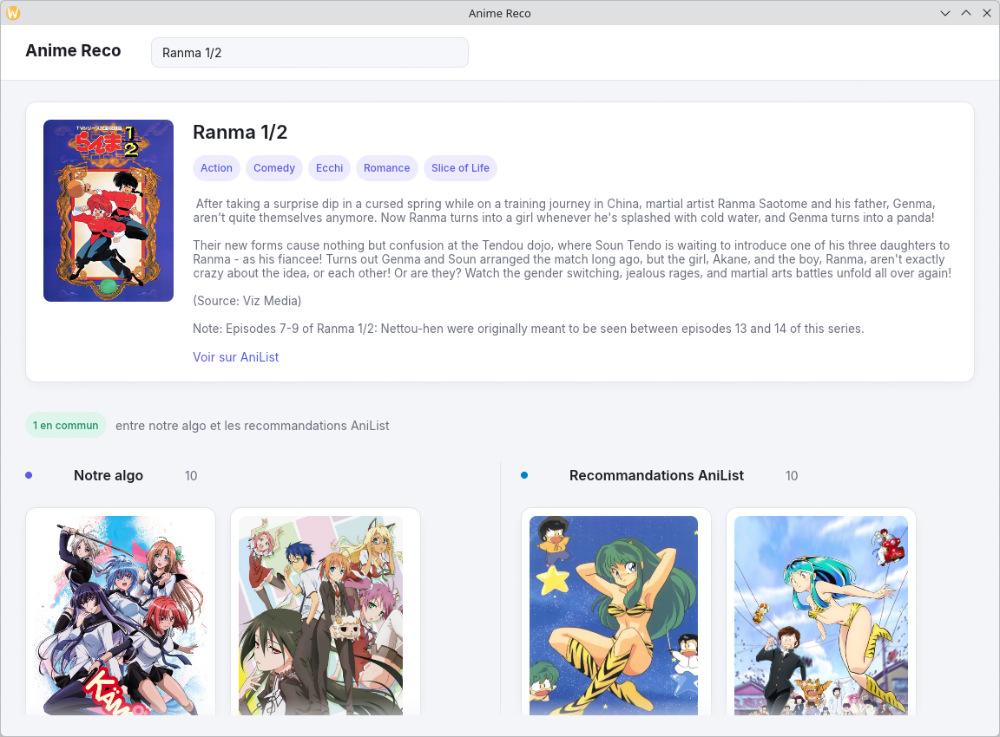

# anireco-standalone



Pick an anime, get recommendations, side by side with AniList's own community picks so you can see where they agree.

A native desktop app: one executable plus one data file, no server, no browser. Builds for Linux, Windows and macOS.

## How it works

- **Data**: ~20k AniList anime, each with an embedding of its title and synopsis, computed once by [anime_reco](https://github.com/Konosprod/miniature-octo-lamp) and exported to `data/anime.db` (SQLite).
- **Recommendations**: the closest anime by cosine similarity, minus the same franchise (sequels, spin-offs…).
- **App**: Rust + [egui](https://github.com/emilk/egui), with all data loaded in memory at startup.

## Run

```sh
cargo run --release -- data/anime.db
```

`data/anime.db` isn't in the repo (~400 MB). Export it from anime_reco with `just export-sqlite <path>`.

Release binaries for each OS are built by GitHub Actions when a `v*.*.*` tag is pushed.
